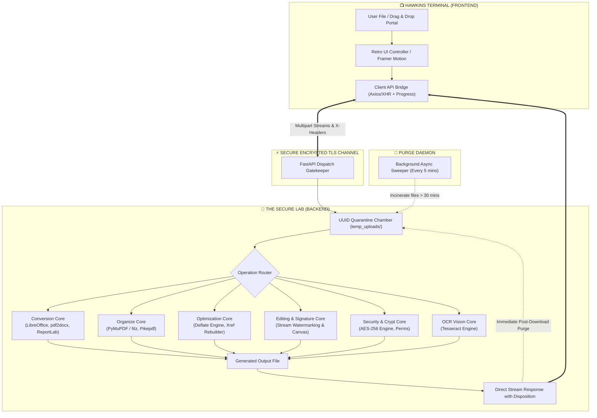

# 📻 ⚡ STRANGEPDF: THE HAWKINS NATIONAL LABORATORY DOSSIER 🚲🧇
> *"PDFs Have Never Been This Strange."*  
> *"Everything You Need for PDFs. Nothing Strange About It."*

---

## 🔬 PROJECT CLASSIFICATION & OVERVIEW

**StrangePDF** is a production-grade, privacy-first, all-in-one document processing portal disguised as a 1984 government research terminal. Built for everyday townspeople, researchers, and rogue agents alike, it eliminates bureaucratic software installations and mandatory registrations.

Unlike conventional utilities that sacrifice identity for sterile corporate grayness, StrangePDF fuses modern high-performance document manipulation engines with the eerie, neon-lit, supernatural atmosphere of 1980s Hawkins, Indiana.

### 📼 The Core Directive
- **Free & Borderless Access**: Public frequency; no accounts, no registrations, no passwords demanded to operate.
- **Relentless Utility**: 25+ military-grade document tools across Conversion, Organization, Optimization, Editing, Security, and OCR.
- **The Zero-Retention Protocol**: What happens in the Upside Down stays in the Upside Down. Files are processed in isolated quarantine chambers and vaporized permanently upon extraction or timeout.

---

## 🎨 THE HAWKINS LAB AESTHETIC PALETTE

The visual interface is strictly calibrated to the authentic five-color 1984 surveillance spectrum:

| Terminal Code | Designation | Role & Application |
| :--- | :--- | :--- |
| **`#C33149`** | **Crimson Red** | Core transmitters, primary triggers, warning beacons, and glowing neon conduits |
| **`#A8C256`** | **Retro Lime** | Transmission success indicators, secondary triggers, green phosphor CRT readouts |
| **`#F3D9B1`** | **Warm Cream** | Laboratory parchment, document workspace surfaces, retro beige microcomputer chassis |
| **`#C29979`** | **Vintage Tan** | Molded plastic borders, 4px dropped shadow offsets, structural card divisions |
| **`#A22522`** | **Deep Blood Red** | Heavy surveillance headers, the Void background, emergency notices, dark footer |

Complementary sensory effects: Scanline CRT interlacing overlays, flickering vacuum tube button glows, physical drop-shadow button depressions, and vintage 1980s typography featuring *Bebas Neue*, *Space Grotesk*, and *Inter*.

---

## 🏛️ HIGH-LEVEL ARCHITECTURAL DESIGN

StrangePDF operates on a decoupled client-server architecture engineered to safeguard document integrity while guaranteeing complete privacy isolation.

---

## 🗄️ SUBSYSTEM BREAKDOWN

### 1. The Client Transmission Deck (Frontend)
- **Framework**: React 18 with TypeScript on Vite
- **Styling**: Tailwind CSS with custom Hawkins palette extensions & retro hardbox shadows
- **Atmospherics**: CSS CRT scanline matrices, neon glows, vintage status gauges
- **Interactions**: Real-time upload progress telemetry, instant client-side thumbnail carousel previews, multi-page drag arrangements

### 2. The Core Synthesis Engine (Backend)
- **Framework**: Python 3.11 with FastAPI (Asynchronous REST Architecture)
- **Conversion Subsystem**: Headless LibreOffice virtualization with Python-Docx / ReportLab fallbacks for DOCX, XLSX, PPTX, and image pipelines.
- **Manipulation Subsystem**: High-velocity binary transformations via `PyMuPDF` (`fitz`) and `pikepdf` for sub-second merging, splitting, reordering, and angle rotation.
- **Cryptographic Vault**: Native AES-128/256 cipher integration via `pypdf` for password locking, credential verification, and permission stripping.
- **Optical Reader**: `pytesseract` integrated OCR parsing scanned textual artifacts from rasterized document pages.

### 3. The Demogorgon Clean-Up Protocol (Privacy Architecture)
- **Quarantine Isolation**: Each document job spawns a cryptographically randomized UUID directory on ephemeral storage.
- **No Third-Party Intermediaries**: Documents never touch commercial external APIs or third-party cloud LLMs.
- **Volatile Password Handling**: Passwords exist solely in ephemeral memory buffers during stream decryption and are strictly forbidden from logging systems.
- **Dual-Phase Elimination**:
  1. *Immediate Phase*: Fast background task executes `shutil.rmtree` upon file stream completion.
  2. *Daemon Phase*: Standalone background async worker sweeps quarantine disks every 300 seconds to purge orphaned files exceeding lifespan.

---

## 🎛️ COMPLETE CAPABILITY INDEX (THE 25+ PROTOCOLS)

- 📄 **Word to PDF & PDF to Word**: Bidirectional semantic document preservation.
- 🖼️ **JPG to PDF & PDF to JPG**: High-fidelity image binding & multi-page raster extraction (ZIP packaged).
- 📊 **Excel to PDF & PDF to Excel**: Tabular structured conversion and data sheet extraction.
- 📽️ **PowerPoint to PDF & PDF to PowerPoint**: Presentation slide rendering and deck creation.
- 🧬 **Merge, Split, Rotate & Reorder**: Structural document surgery with visual page verification.
- 🗜️ **Compress PDF**: Real, mathematically calculated compression (*Low*, *Balanced*, *Extreme*) with zero synthetic metrics.
- 🩺 **Repair PDF**: Xref structural rebuilding and stream sanitization for corrupt documents.
- ✍️ **Add Text, Watermark, Page Numbers & Sign**: Visual stamping and custom annotations.
- 🔐 **Protect, Unlock, Change Password & Remove Restrictions**: Military-grade document security.
- 👁️ **OCR Scanner**: Optical character recognition turning scanned images into searchable text.

---

## 📡 BROADCAST TRANSMISSION NOTICE

> *"Your documents are processed securely and are not permanently stored by StrangePDF. Temporary files are automatically deleted after processing and download."*

  <b>HAWKINS, INDIANA • DIVISION OF PDF RESEARCH • 1984 - 2026</b>

